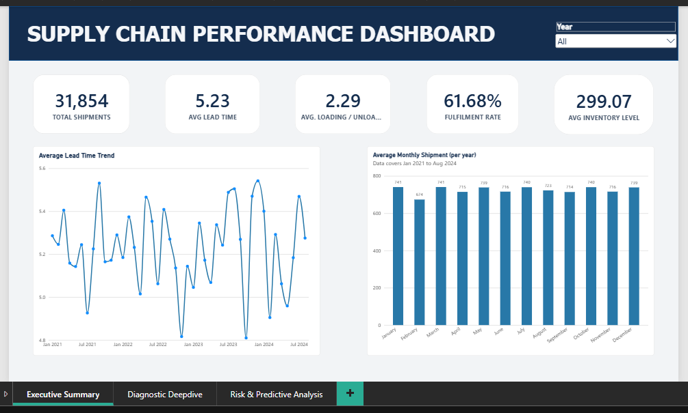

# Supply Chain Performance Dashboard

A 3-page Power BI dashboard that tests whether supplier reliability, dock efficiency, customs clearance time and risk classification explain shipment delays.



## Business question

Which operational factors drive late deliveries, and can the existing risk classification be used to prioritise shipments?

## Key findings

- **Delay probability is about 70% in every risk class** (Low 70.58%, Moderate 69.63%, High 69.82%). The current risk tiers have no predictive value.
- **Lead time stays at 5.2 to 5.3 days** across all supplier reliability and dock efficiency tiers, and fulfilment stays between 61% and 63%.
- **75% of shipments (about 24K) are classed High Risk**, so the classification cannot separate shipments that need attention from those that do not.
- **Takeaway:** none of these fields separates good shipments from bad ones. A real analysis would need other drivers such as route, carrier or order data.

## Dashboard pages

| Page | What it shows |
| --- | --- |
| Executive Summary | Total shipments, average lead time, loading/unloading time, fulfilment rate, average inventory level, lead time trend, monthly shipment volume |
| Operational Bottleneck Analysis | Average lead time and fulfilment by supplier reliability, dock efficiency and customs clearance tier |
| Shipment Risk & Predictive Analysis | Delay probability, delivery deviation, ETA deviation and shipment volume by risk classification |

All pages have a year slicer.

## Data

- **Source:** Kaggle logistics dataset (add the dataset name and link here).
- **Size:** 31,872 shipment records, January 2021 to August 2024.
- **Important:** the data is simulated. A flat result is therefore expected, and the value of this project is the method: building the tiers, testing each assumed driver and reporting a null result honestly.

## Method

1. Cleaned the shipment table in Power Query (table: `cleaned_fleet_supply_chain`).
2. Created calculated columns that group shipments into tiers:
   - Supplier reliability: Low (< 0.5), Medium (0.5 to 0.8), High (> 0.8)
   - Dock efficiency: Slow (> 3 hrs), Moderate (1 to 3 hrs), Fast (< 1 hr)
   - Customs clearance: Slow (< 3 days), Moderate (1 to 3 days), Fast (< 1 days)
3. Wrote DAX measures for shipment count, average lead time, fulfilment rate, loading/unloading time and inventory level.
4. Compared average lead time, fulfilment and delay probability across each tier.

## Repository contents

```
supply-chain-performance-dashboard/
  Supply_Chain_Performance.pbix
  screenshots/
  README.md
```

## How to open

Download `Supply Chain Performance.pbix` and open it in Power BI Desktop (free for Windows).

## Skills demonstrated

Power BI, DAX, Power Query, data modelling, KPI design, hypothesis testing with business data, honest reporting of null results.

## Author

Oluwatosin Oke | [LinkedIn](https://www.linkedin.com/in/oke-o-a55bb1262/) | [Portfolio](https://glittering-pavlova-9a68b0.netlify.app/)
